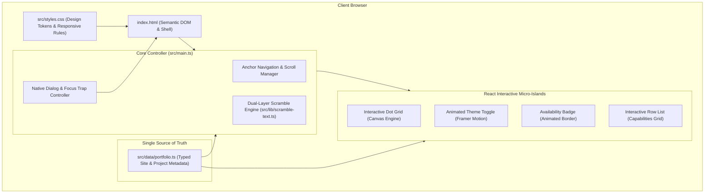

# Santanu Dey — Software Engineer & AI Systems Portfolio

> A high-performance, editorial-brutalist software engineering portfolio built with React 19, TypeScript, and Vite, featuring deterministic accessible typography animations, native dialog architecture, and rigorous multi-viewport responsive design.

---

## Overview

This repository houses the source code for the personal portfolio of **Santanu Dey** (Full-Stack & AI Systems Engineer). The site is engineered to present software architecture, systems projects, and technical capabilities to senior engineers, recruiters, and hiring managers with zero marketing fluff, instant landing performance, and full accessibility compliance.

### Design & Engineering Philosophy
- **Editorial Brutalist Identity:** Sharp typographic contrast, monochromatic tonal palette with accent highlights, hairline architectural borders, condensed display headlines, and generous, intentional whitespace.
- **Performance First:** Pure CSS layout foundations combined with targeted React micro-islands for heavy interactive elements. Zero layout shifts, deterministic scroll resets, and sub-10s production build times.
- **Accessibility as a Requirement:** Dual-layer semantic DOM architecture guaranteeing that screen readers and search indexers never encounter animated or scrambled glyphs. Full keyboard navigation and native WCAG AAA/AA contrast compliance.

---

## Architecture Overview

The portfolio uses an **islands-style hybrid architecture**. The core document structure, navigation, project showcases, and typography hierarchy are declared semantically in `index.html` and styled via `src/styles.css`. Complex dynamic systems (interactive canvas background, theme switcher, availability status badge, and expandable skills matrix) are mounted as isolated React roots managed by `src/main.ts`.



---

## Key Engineering Highlights

### 1. Dual-Layer Accessible Scramble Reveal
Conventional text-scramble effects mutate text nodes directly, temporarily exposing random, meaningless strings (`"Nn8%mpb"`, `"AWZW&N"`) to screen readers, SEO crawlers, and accessibility trees. This portfolio implements a dual-layer architecture:
- **Semantic Layer:** A `.sr-only` container preserves pure, unmutated text (`Santanu Dey`) for assistive technology and crawlers at all times.
- **Visual Display Layer:** An `aria-hidden="true"` element resolves characters deterministically over a bounded $450\text{ms}$–$520\text{ms}$ duration using `requestAnimationFrame`.
- **Reduced Motion:** If `prefers-reduced-motion: reduce` is detected, animations bypass completely, displaying static text instantaneously.

### 2. High-Performance Canvas Dot Grid
An interactive background canvas tracks cursor velocity and proximity, applying localized physics displacement to a mathematical grid. The engine isolates repaints, caps device-pixel ratios on high-DPI displays, and uses integer coordinate calculations to prevent CPU/GPU throttling.

### 3. Native `<dialog>` Modal Lifecycle & Focus Trapping
Technical project case studies open inside native HTML5 `<dialog id="project-modal">` elements:
- Managed via `showModal()`, automatically enforcing top-layer rendering without `z-index` wars.
- Background scroll lock is applied synchronously via `document.body.style.overflow = 'hidden'`.
- Native `Escape` key dismisses the dialog, automatically restoring background scrolling and returning focus to the activating CTA button.
- Responsive height bounds (`86dvh`) prevent mobile navigation bar collisions on iOS Safari and Android Chrome.

### 4. Zero-Overflow Responsive Geometry
All viewports from $320\text{px}$ (iPhone SE 1) up to $1920\text{px}+$ (ultrawide displays) maintain exact `scrollWidth === innerWidth`:
- Navigation bar converts to a touch-momentum horizontal scroll strip (`overscroll-behavior-x: contain`) without triggering page back-swipes or pull-to-refresh conflicts.
- Sticky header clearance dynamically shifts `scroll-margin-top` ($108\text{px}$–$116\text{px}$) so anchor-linked headings are never obscured beneath the navigation bar.
- Interactive controls maintain a minimum $44 \times 44\text{px}$ touch target with `touch-action: manipulation` to eliminate the 300ms mobile tap delay.

---

## Technology Stack

| Layer | Technologies |
| :--- | :--- |
| **Core Framework** | React 19, TypeScript 5.7, Vite 6 |
| **Styling & Design** | Tailwind CSS 3.4, PostCSS, Custom CSS Variables |
| **UI Primitives** | Radix UI (`@radix-ui/react-slot`), Class Variance Authority (`cva`), `clsx`, `tailwind-merge` |
| **Animation & Motion** | Framer Motion 14, Native `requestAnimationFrame` |
| **Typography** | Plus Jakarta Sans (Display / Primary), DM Sans (Editorial Secondary) |
| **Tooling** | TypeScript Compiler (`tsc`), Autoprefixer |

---

## Featured Project Showcase (Documented in Portfolio)

The portfolio details technical architecture and verified benchmarks for three primary engineering projects:

1. **Reverse Engineering Anything (REA)**
   - *Domain:* AI Systems · Binary Analysis · Decompilation Workbench
   - *Stack:* TypeScript, Node.js, React, SQLite, AST Traversal, Model Context Protocol (MCP)
   - *Highlights:* Multi-hop call graphs, content-addressed evidence triage, on-device local LLM execution with zero external network leakage, and sub-150ms AST traversal across 10,000+ nodes.

2. **RailFlow**
   - *Domain:* Full-Stack Systems · Multi-Tier Cloud Architecture · CI/CD
   - *Stack:* React, TypeScript, Vite, Node.js, Python (FastAPI), MongoDB Atlas, Render, Vercel
   - *Highlights:* Decoupled 3-tier architecture, automated GitHub Actions deployments, cross-origin security policies, and sub-45ms edge-cached asset delivery on Vercel CDN.

3. **SANTA — Autonomous AI Assistant**
   - *Domain:* Agentic AI · Multimodal Voice Processing · Local LLMs
   - *Stack:* Python, FastAPI, LangGraph, Ollama, ChromaDB, Whisper STT
   - *Highlights:* Cyclic LangGraph state machines enforcing structured tool calling, sub-200ms vector semantic memory retrieval, and low-latency voice-to-text audio streaming.

---

## Repository Structure

```text
portf/
├── index.html                   # Semantic HTML shell, SEO metadata & modal dialogs
├── package.json                 # Dependencies, scripts, and build configuration
├── tsconfig.json                # TypeScript strict configuration & path aliases (@/*)
├── vite.config.ts               # Vite bundler configuration & local network host
├── tailwind.config.js           # Tailwind theme tokens, typography, and borders
├── postcss.config.js            # PostCSS Autoprefixer plugin configuration
├── public/                      # Static assets, favicon, resume PDF, and robots.txt
│   ├── favicon.svg              # Scalable SVG site branding
│   ├── resume.pdf               # Static downloadable PDF resume
│   └── robots.txt               # Crawler directives
├── src/
│   ├── main.ts                  # Application bootstrap, DOM controllers & React mounts
│   ├── styles.css               # Editorial CSS design system, typography & breakpoints
│   ├── components/
│   │   └── ui/                  # React components (ThemeToggle, AnimatedBorder, etc.)
│   ├── data/
│   │   └── portfolio.ts         # Strongly-typed single source of truth for site data
│   └── lib/
│       ├── scramble-text.ts     # Accessible character scramble & resolve engine
│       └── utils.ts             # Class merging & Tailwind utility helpers
└── docs/                        # Architecture diagrams and design references
```

---

## Engineering Decisions & Trade-Offs

### 1. Hybrid HTML Shell + React Micro-Islands vs. Pure Single-Page React App (SPA)
- **Decision:** Use semantic `index.html` as the primary document shell and mount React selectively for interactive components (`InteractiveDotGrid`, `AnimatedThemeToggle`, `AvailabilityBadge`, `InteractiveRowList`).
- **Trade-off:** Requires coordinating state between vanilla DOM listeners and React component mounts. In exchange, the site achieves near-instant First Contentful Paint (FCP), zero SEO indexing friction, and zero dependency on client-side routing hydration.
- **Alternative:** Full client-side SPA (e.g. Next.js / Create React App). Rejected due to unnecessary bundle overhead and hydration complexity for a single-page portfolio document.

### 2. Native `<dialog>` vs. Custom React Portals
- **Decision:** Utilize the standard HTML5 `<dialog>` API.
- **Trade-off:** Requires handling backdrop styling and polyfill awareness for older legacy engines. Gained built-in accessibility semantics (`role="dialog"`, `aria-modal`), top-layer browser promotion (immune to parent `z-index` and `overflow: hidden`), and native `Escape` key handling.
- **Alternative:** Third-party React modal libraries. Rejected to reduce dependency bloat.

### 3. Pure CSS Scroll Margins vs. JavaScript Scroll Hijacking
- **Decision:** Calibrate sticky header clearance purely via CSS `scroll-margin-top` across breakpoints (`84px` desktop down to `108px` mobile).
- **Trade-off:** Static breakpoint declarations require careful alignment with actual header heights. Gained 100% native smooth scrolling without scroll-jacking, layout jitter, or main-thread lag.
- **Alternative:** Intercepting click events with `event.preventDefault()` and calculating `window.scrollTo()` offsets via JavaScript. Rejected due to unreliability during address bar expansions on mobile browsers.

---

## Local Development & Setup

### Prerequisites
- [Node.js](https://nodejs.org/) (v18.0.0 or higher recommended)
- `npm` (v9.0.0 or higher)

### Installation
1. Clone the repository:
   ```bash
   git clone https://github.com/mrsantanu21/portfolio.git
   cd portfolio
   ```

2. Install dependencies:
   ```bash
   npm install
   ```

3. Launch local development server:
   ```bash
   npm run dev
   ```
   The site will be available at `http://localhost:3000` (and on local network host `http://0.0.0.0:3000`).

---

## Available Scripts

| Command | Action |
| :--- | :--- |
| `npm run dev` | Starts Vite dev server with Hot Module Replacement (HMR) on port 3000 |
| `npm run build` | Compiles TypeScript and creates optimized production bundle in `dist/` |
| `npm run preview` | Serves local production build from `dist/` for verification |
| `npm run typecheck` | Executes strict TypeScript compiler verification without emitting files |

---

## Verification & Quality Assurance

- **Type Safety:** Verified with `npm run typecheck` (zero TypeScript errors under strict mode).
- **Production Build:** Verified with `npm run build` (clean bundle generation in $\sim 7\text{s}$).
- **Automated Viewport Suite:** Tested across 10 standard device resolutions ($320\text{px}$ to $1920\text{px}$) with zero horizontal scroll overflow.
- **Accessibility:** Tested with prefers-reduced-motion media query emulation and screen-reader DOM inspection.

---

## License

This project is licensed under the [MIT License](LICENSE).
